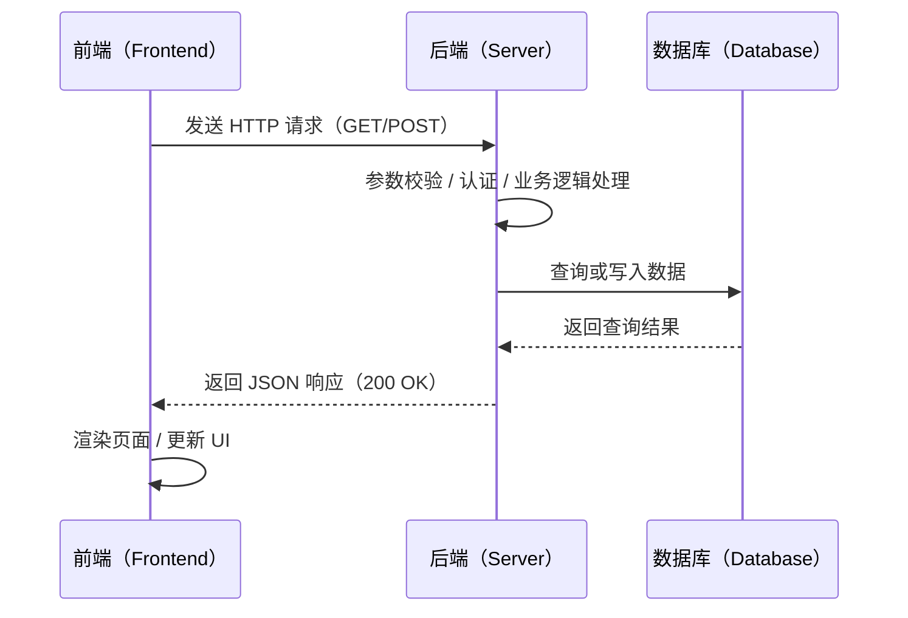
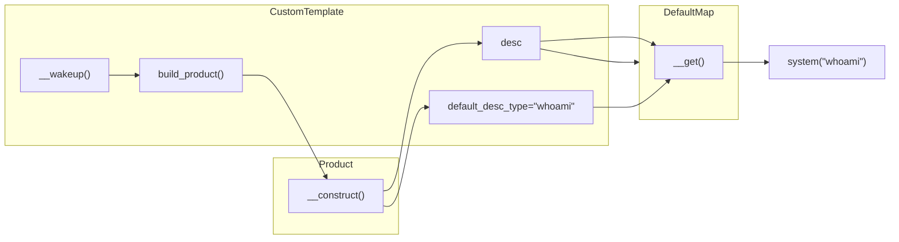

---
# try also 'default' to start simple
theme: ../seriph-theme
fonts:
  sans: 'PT Serif, Noto Color Emoji'
  serif: 'PT Serif, Noto Color Emoji'
# random image from a curated Unsplash collection by Anthony
# like them? see https://unsplash.com/collections/94734566/slidev
background: /Web02-bg.png
# some information about your slides (markdown enabled)
title: Web - Serialization
info: |
  Introduction to Serialization

# apply UnoCSS classes to the current slide
class: text-center
# https://sli.dev/features/drawing
drawings:
  persist: false
# slide transition: https://sli.dev/guide/animations.html#slide-transitions
transition: slide-left
# enable MDC Syntax: https://sli.dev/features/mdc
mdc: true
# duration of the presentation
duration: 40min
---

# Introduction to Serialization, Inheritance and the Prototype Chain Attacks

Blue-Whale Freshman Training

---
layout: two-cols-header
---

# 前言(~~目录~~)
希望能讲清楚(~~不清楚的地方请拷打我😢~~)

::left::

- 什么是序列化

    为什么需要序列化？

- 序列化有哪些？

    PHP、JSON、XML、Pickle、Java...(CTF Web 手大概了解这些就行了...)  
    你当然可以自行实现一个自己的序列化标准

- 序列化在 **Web** 中的真实的使用场景（会用才会打）

    <span v-mark.circle.red>Cookie</span>、传递请求

- 攻击中怎么利用（反）序列化

::right::

- 原型链和继承链的原理
- 一些小技巧

<!--
对于这个序列化的应用场景，并不是说 cookie 的应用场景更加广泛，JSON 作为请求载体也很广泛，而是说在安全角度，Cookie 的反序列化的利用价值可能更大。

PHP 的序列化的应用价值其一就是 session，在服务器端写入本地硬盘做持久化的储存.  
第二就是对一些具有引用关系的对象进行序列化，这种关系是 JSON 难以表示出来的.

那么 XML 其实就涉及 XML 实体注入的板块了，属于是一个更细的板块

我们这里主要讲一下 PHP 反序列化、Pickle 反序列化、JSON 反序列化
-->

---

# 前言
真正的前言

这是 PPT 写了一半之后写的（~~是不是应该叫后记呢~~）

其实这些内容的知识很多，部分内容理解其背后原理会比较难（比如 Python 里的作用域等知识），讲清楚也很难，而这个时候如果大家对这门语言的基本语法都有问题就会导致学习更加困难，所以希望大家花时间先学一些对应模块涉及到的语言基础知识，动手写一写，学明白了就开始学本次培训涉及到的一个模块，不用一口气把 Pickle、PHP、Java 啥的全搞懂了。

然后大家在学习时可以多参考一下附录中的参考资料，不懂的地方去追问大模型（但一切应当以 Manual 为准，尽管 Manual 也有笔误的地方），本次培训只能是给大家一个浅显的认知和学习路线，大家还是要自己去花时间深入了解。

<b>讲解视频在<Link to="29">最后一页</Link>～</b>

---
layout: two-cols
---

# 序列化与反序列化
什么是序列化？

### 广义来说

想想这些场景下数据是以怎样的形式存在的？

- Web
    - 登录发送账号密码
    - 加载个人信息
    - 电商网站加载商品信息
- 游戏
    - 你的血量掉了
    - 退出游戏，存档
- 办公
    - 保存 Word 文档
    - 加载 PPT

::right::

### 狭义来说



- 通用：JSON、XML、YAML
- 语言自行实现：PHP、Pickle（Python）、Java

<br/>

<v-click>
序列化就是将复杂的数据结构转换为可以发送和接收的“扁平化”字节序列流的过程。
</v-click>

---

# <span class="text-color-lime">序列化与反序列化</span>

- 发送与接收数据
- 保存与加载数据

→ 都需要进行 `Serialize` 将数据“扁平化”.

<br>
<div class="flex mt-6 text-shadow-xl relative"
  v-click="1"
  v-motion
  :initial="{ opacity: 0 }"
  :enter="{ opacity: 1 }"
>
<div class="border-3 border-lime bg-lime-400/5 p-4 rounded-lg">
Sender/Dumper
<div class="border-3 rounded-md p-2 m-2">
  DumpData
</div>
一堆Dumper<br/>
能看懂的二进制
</div>

<div class="flex-1">
</div>

<div class="border-3 border-yellow bg-yellow-400/5 p-4 rounded-lg"
  v-click="3"
  v-motion
  :initial="{ opacity: 0 }"
  :enter="{ opacity: 1 }"
>
API
    <div class="border-3 rounded-md p-2 m-2 border-red-600 bg-red-600/20">
    Serialize
    </div>
人类友好的字节流<br/>
（一般）
</div>

<div class="flex-1">
</div>

<div class="border-3 border-yellow bg-yellow-400/5 p-4 rounded-lg"
  v-click="3"
  v-motion
  :initial="{ opacity: 0 }"
  :enter="{ opacity: 1 }"
>
API
    <div class="border-3 rounded-md p-2 m-2 border-red-600 bg-red-600/20">
    Unserialize
    </div>
一堆Loader<br/>
能看懂的二进制

</div>

<div class="flex-1">
</div>

<div class="border-3 border-sky-500 bg-sky-500/5 p-4 rounded-lg">
Receiver/Loader

<div class="border-3 rounded-md p-2 m-2"
  >
  ParseData
</div>

使用这个数据<br/>
开始业务

</div>

<div class="w-142 absolute top-17 left-37"
  v-motion
  :initial="{ opacity: 1 }"
  :enter="{ opacity: 1 }"
  :click-2="{ opacity: 0 }">
   <div>
      <div class="border-2 rounded-md m-2 h-0"></div>
      <div class="border-2 rounded-md m-2 h-0 w-5 rotate-45 absolute right--1 top--1.5"></div>
      <div class="border-2 rounded-md m-2 h-0 w-5 rotate--45 absolute right--1 bottom--1.5"></div>
   </div>
</div>

<div class="w-26 absolute top-17 left-37"
  v-motion
  :initial="{ opacity: 0 }"
  :enter="{ opacity: 0 }"
  :click-4="{ opacity: 1 }">
   <div>
      <div class="border-2 rounded-md m-2 h-0"></div>
      <div class="border-2 rounded-md m-2 h-0 w-5 rotate-45 absolute right--1 top--1.5"></div>
      <div class="border-2 rounded-md m-2 h-0 w-5 rotate--45 absolute right--1 bottom--1.5"></div>
   </div>
</div>

<div class="w-27 absolute top-17 left-96"
  v-motion
  :initial="{ opacity: 0 }"
  :enter="{ opacity: 0 }"
  :click-4="{ opacity: 1 }"
>
   <div>
      <div class="border-2 rounded-md m-2 h-0"></div>
      <div class="border-2 rounded-md m-2 h-0 w-5 rotate-45 absolute right--1 top--1.5"></div>
      <div class="border-2 rounded-md m-2 h-0 w-5 rotate--45 absolute right--1 bottom--1.5"></div>
   </div>
</div>

<div class="w-27 absolute top-17 left-153"
  v-motion
  :initial="{ opacity: 0 }"
  :enter="{ opacity: 0 }"
  :click-4="{ opacity: 1 }"
>
   <div>
      <div class="border-2 rounded-md m-2 h-0"></div>
      <div class="border-2 rounded-md m-2 h-0 w-5 rotate-45 absolute right--1 top--1.5"></div>
      <div class="border-2 rounded-md m-2 h-0 w-5 rotate--45 absolute right--1 bottom--1.5"></div>
   </div>
</div>
</div>

<v-click at="6"></v-click>

---

# 朴(~~xu~~)素(~~jia~~)的序列化
C 的“艺术”

先上一个结构体

```c {all|1-3|6-10|9}{lines:true}
struct Skill {
    char skill[100];
    int duration;
};

struct Person {
    char name[25];
    int age;
    struct Skill skill;
};
```

（~~这明明是两个~~）

这就是我们的数据的形式了，我们现在需要保存我们程序运行的数据，然后读取它。

---

# 二进制序列化
`fread()` 与 `fwrite()`

````md magic-move {lines: true}

```c {3-12|3-4|6|7-7|8-11}{lines:true}
...
int main() {
    struct Skill sk = {"I don't know", 114514};
    struct Person p = {"Bob", 18, sk};

    FILE* file = fopen("serialization_res.txt", "ab");
    fwrite((void*)&p, sizeof(struct Person), 1, file);
    fseek(file, 0, SEEK_SET);
    fread((void*)&p, sizeof(struct Person), 1, file);
    printf("%s %d\n", p.name, p.age);
    printf("%s %d\n", p.skill.skill, p.skill.duration);
    fclose(file);
    return 0;
}
```

```c
struct Skill sk = {/* char skill[100]= */"I don't know", /* int duration= */114514};
struct Person p = {/* char name[25]= */"Bob", /* int age= */18, /* struct Skill skill= */sk};

FILE* file = fopen("serialization_res.txt", "ab");
fwrite((void*)&p, sizeof(struct Person), 1, file);
```
````

<v-click at="5">

看看最终的结果：

<v-click at="6">
确实是扁平化了吧
</v-click>

```bash
$ ~> xxd serialization_res.txt
00000000: 426f 6200 0000 0000 0000 0000 0000 0000  Bob.............
00000010: 0000 0000 0000 0000 0000 d000 1200 0000  ................
00000020: 4920 646f 6e27 7420 6b6e 6f77 0000 0000  I don't know....
00000030: 0000 0000 0000 0000 0000 0000 0000 0000  ................
00000040: 0000 0000 0000 0000 0000 0000 0000 0000  ................
00000050: 0000 0000 0000 0000 0000 0000 0000 0000  ................
00000060: 0000 0000 0000 0000 0000 0000 0000 0000  ................
00000070: 0000 0000 0000 0000 0000 0000 0000 0000  ................
00000080: 0000 0000 52bf 0100                      ....R...
```
</v-click>

---
layout: image-right
image: /20251130-60596f60233b1d1e.png
backgroundSize: contain
---

# 这也算序列化？
to define or not to define

其实我想表达，计算机中某些定义并不是死的，概念的边界是模糊的，只要我们搞清楚底层究竟是怎么做的，那么概念就可以被我们延伸，思维要活起来。

---

# PHP 序列化

<div v-click.hide>
我们先来一个 Cookie 反序列化与 POP 链的例子
</div>

<v-click at="1">
<p>等等，我们还是循序渐进吧！看看下面的例子：</p>
</v-click>

<v-click>

````md magic-move {lines: true}

```php {2-14|3-4|13|14}{lines:true}
<?php
class User {
    public $name;
    private $id;
    public function __construct($name, $id) {
        $this->name = $name;
        $this->id  = $id;
    }
}

$user = new User("Bob", 12);
var_dump($user);
print_r(serialize($user) . "\n");
var_dump(unserialize($_GET["user"]));
?>
```

```php {1|2-7|8|9-13|all}
// ?user=O:4:%22User%22:2:%7Bs:4:%22name%22;s:3:%22Bob%22;s:8:%22%00User%00id%22;i:11;%7D
object(User)#1 (2) {
  ["name"]=>
  string(3) "Bob"
  ["id":"User":private]=>
  int(12)
}
O:4:"User":2:{s:4:"name";s:3:"Bob";s:8:"0️⃣User0️⃣id";i:12;}
object(User)#2 (2) {
  ["name"]=>
  string(3) "Bob"
  ["id":"User":private]=>
  int(11)
}
```
````

</v-click>

---

```php
O:4:"User":2:{s:4:"name";s:3:"Bob";s:8:"0️⃣User0️⃣id";i:12;}
```

<v-drag-arrow v-click pos="311,66,-160,27" color="#ffffff5e"></v-drag-arrow>
<v-drag-arrow v-click pos="333,70,-143,59" color="#ffffff5e"></v-drag-arrow>
<v-drag-arrow v-click pos="381,71,-160,83" color="#ffffff5e"></v-drag-arrow>

- 类型：`s`，表示是一个字符串；
- 长度/数量：`8`，表示长度为 `8`；
- 值：`0️⃣User0️⃣id`；

注意：

<div grid="~ cols-2 gap-2">
<div>

- 对象的 private 成员会在名前添加类名；protected 成员会在名前添加“*”；这些前置值在两边都有 null 字节。  

</div><div>

- 反序列化字节流中的类型：  
`b`: boolean; `i`: integer; `d`: double; `N`: NULL;  
`s`: string;&nbsp;&nbsp;&nbsp;&nbsp;&nbsp;`a`: Array;&nbsp;&nbsp;&nbsp;&nbsp;`O`: Object.
<span v-mark.circle.red>`R`: reference</span>

</div>

</div>

https://www.php.net/manual/zh/function.serialize.php

了解完格式，我们就知道下面这个参数的做了什么了：

```js
?user=O:4:%22User%22:2:%7Bs:4:%22name%22;s:3:%22Bob%22;s:8:%22%00User%00id%22;i:11;%7D
?user=O:4:"User":2:{s:4:"name";s:3:"Bob";s:8:"0️⃣User0️⃣id";i:11;}
```

---
layout: two-cols-header
---

# 实战一下
~~补兑，还没讲最重要的魔术方法😭~~

::left::

- `__wakeup()` 执行 `unserialize()` 时，先会调用这个函数
- `__sleep()`  执行 `serialize()` 时，先会调用这个函数
- `__call()` 在对象上下文中调用不可访问的方法时触发
- `__callStatic()` 在静态上下文中调用不可访问的方法时触发
- `__get()` 用于从不可访问的属性读取数据或者不存在这个键都会调用此方法
- `__set()` 用于将数据写入不可访问的属性
- `__isset()` 在不可访问的属性上调用 `isset()` 或 `empty()` 触发

::right::

- `__unset()` 在不可访问的属性上使用 `unset()` 时触发
- `__toString()` 把类当作字符串使用时触发
- `__invoke()` 当尝试将对象调用为函数时触发
- `__destruct()` 对象被销毁时触发
- `__construct()` 创建对象时触发
- `__serialize()` 自定义序列化接口（≥7.4.0）
- `__unserialize()` 自定义反序列化接口（≥7.4.0）
- `static __set_state()` `var_export()` 时触发
- `__debugInfo()` `var_dump()` 时触发
- `__clone()` `clone` 时触发

---

## 魔术方法 `__wakeup()`

`unserialize()` 会检查是否存在一个 `__wakeup()` 方法。如果存在，则会先调用 `__wakeup()` 方法，预先准备对象需要的资源。

`__wakeup()` 经常用在反序列化操作中，例如重新建立数据库连接，或执行其它初始化操作。

安全角度来看这个方法更多的是从实战出发，看有没有能够利用的点.

```php {*}{maxHeight:'300px'}
<?php
class User {
    public $first_name;
    public $last_name;
    private $full_name;
    public function concat($first, $second) {
        return $first . " " . $second;
    }
    public function __construct($first_name, $last_name) {
        $this->first_name = $first_name;
        $this->last_name = $last_name;
        $this->full_name = $this->concat($first_name, $last_name);
    }
    public function __wakeup() {
        $this->full_name = $this->concat($this->first_name, $this->last_name);
    }
}

$ss = urldecode("O:4:\"User\":3:{s:10:\"first_name\";s:4:\"41ex\";s:9:\"last_name\";s:5:\"Green\";s:15:\"\x00User\x00full_name\";s:10:\"Alex Green\";}");
var_dump(unserialize($ss));
?>

object(User)#1 (3) {
  ["first_name"]=>
  string(4) "41ex"
  ["last_name"]=>
  string(5) "Green"
  ["full_name":"User":private]=>
  string(10) "41ex Green"
}
```

---

## 魔术方法 `__sleep()`

`serialize()` 函数会检查类中是否存在一个魔术方法 `__sleep()`。如果存在，该方法会先被调用，然后才执行序列化操作。此功能可以用于清理对象，并返回一个包含对象中所有应被序列化的变量名称的数组。 如果该方法未返回任何内容，则 `null` 被序列化，并产生一个 `E_NOTICE` 级别的错误。

**`__sleep()` 不能返回父类的私有成员的名字。这样做会产生一个 `E_NOTICE` 级别的错误。使用 `__serialize()` 接口替代。**

实际上这个方法的从安全的角度来说只能说是阻止了一些敏感信息的泄漏🤔，但它并不妨碍我在反序列化时为对象添加一些并不存在的属性，也不妨碍我给被 `__sleep()` 过滤掉的属性赋值😜：

```php {*}{lines:true, maxHeight:'220px'}
<?php
class User {
    public $first_name;
    public $last_name;
    private $full_name;

    public function __sleep() {
        return ["first_name", "last_name"];
    }

    public function concat($first, $second) {
        return $first . " " . $second;
    }
    public function __construct($first_name, $last_name) {
        $this->first_name = $first_name;
        $this->last_name = $last_name;
        $this->full_name = $this->concat($first_name, $last_name);
    }

    public function __wakeup() {
        $this->full_name = $this->concat($this->first_name, $this->last_name);
    }
}

$user = new User("Alex", "Green");
print_r(serialize($user) . "\n");
// $ss = urldecode("O:4:\"User\":3:{s:10:\"first_name\";s:4:\"41ex\";s:9:\"last_name\";s:5:\"Green\";s:15:\"\x00User\x00full_name\";s:10:\"Alex Green\";}");
$ss = urldecode("O:4:\"User\":4:{s:10:\"first_name\";s:4:\"41ex\";s:9:\"last_name\";s:5:\"Green\";s:15:\"\x00User\x00full_name\";s:10:\"Alex Green\";s:3:\"age\";i:18;}");
var_dump(unserialize($ss));
?>


O:4:"User":2:{s:10:"first_name";s:4:"Alex";s:9:"last_name";s:5:"Green";}
<br />
<b>Deprecated</b>:  Creation of dynamic property User::$age is deprecated in <b>/var/www/html/tmp.php</b> on line <b>29</b><br />
object(User)#2 (4) {
  ["first_name"]=>
  string(4) "41ex"
  ["last_name"]=>
  string(5) "Green"
  ["full_name":"User":private]=>
  string(10) "41ex Green"
  ["age"]=>
  int(18)
}
```

---

## 魔术方法

其余魔术方法大家自行了解，详细的资料都在附录中了。

---

# 实战一下
Cookie 与 PHP 序列化

```php {all|48,54-56|4-6,23-25|19-21}{lines:true, maxHeight:'400px'}
<?php

class CustomTemplate {
    private $default_desc_type;
    private $desc;
    public $product;

    public function __construct($desc_type='HTML_DESC') {
        $this->desc = new Description();
        $this->default_desc_type = $desc_type;
        // Carlos thought this is cool, having a function called in two places... What a genius
        $this->build_product();
    }

    public function __sleep() {
        return ["default_desc_type", "desc"];
    }

    public function __wakeup() {
        $this->build_product();
    }

    private function build_product() {
        $this->product = new Product($this->default_desc_type, $this->desc);
    }
}

class Product {
    public $desc;

    public function __construct($default_desc_type, $desc) {
        $this->desc = $desc->$default_desc_type;
    }
}

class Description {
    public $HTML_DESC;
    public $TEXT_DESC;

    public function __construct() {
        // @Carlos, what were you thinking with these descriptions? Please refactor!
        $this->HTML_DESC = '<p>This product is <blink>SUPER</blink> cool in html</p>';
        $this->TEXT_DESC = 'This product is cool in text';
    }
}

class DefaultMap {
    private $callback;

    public function __construct($callback) {
        $this->callback = $callback;
    }

    public function __get($name) {
        return call_user_func($this->callback, $name);
    }
}

?>
```

---

# POP Chain (Gadget Chain)
~~弹出链？~~

"漏洞利用链"是指应用程序中一段可以协助攻击者达成特定目标的代码片段。单个漏洞利用链可能不会直接对用户输入造成危害。然而，攻击者的目标可能仅仅是调用一个方法，将他们的输入传递给另一个漏洞利用链。通过这种方式将多个漏洞利用链串联起来，攻击者可以将他们的输入传递到一个危险的"汇点漏洞利用链"，在那里它可以造成最大程度的破坏。

—— PortSwigger



<div absolute bottom-2 right-5>

[试试做个题目👉](https://buuoj.cn/challenges#[NewStarCTF%202023%20%E5%85%AC%E5%BC%80%E8%B5%9B%E9%81%93]Unserialize%20Again)

</div>

---

# Pickle 序列化
Python

{width=550px}

<Transform :scale="0.8">

在 pickle 协议和 JSON ([JavaScript Object Notation](https://json.org/)) 之间有着本质上的差异:

- JSON 是一个文本序列化格式（它输出 unicode 文本，尽管在大多数时候它会接着以 utf-8 编码），而 pickle 是一个二进制序列化格式；
- JSON 是我们可以直观阅读的，而 pickle 不是；
- JSON是可互操作的，在Python系统之外广泛使用，而pickle则是Python专用的；
- 默认情况下，JSON 只能表示 Python 内置类型的子集，不能表示自定义的类；但 pickle 可以表示大量的 Python 数据类型（可以合理使用 Python 的对象内省功能自动地表示大多数类型，复杂情况可以通过实现 specific object APIs 来解决）。
- 不像pickle，对一个不信任的JSON进行反序列化的操作本身不会造成任意代码执行漏洞。

<Transform :scale="0.9">

—— Python3.14 Docs

</Transform>

</Transform>

---

# Pickle 序列化

Pickle 的一些特点

注意：Pickle 将序列化称作“封存”，在我们的讲解中两个名词都在使用. {color=red}

- pickle 会跟踪已经序列化过的对象，这点类似与 PHP 中的引用；
- pickle 是一个二进制序列化格式；
- pickle 可以自定义（反）序列化的结果；
- pickle 使用类似于栈的结构进行序列化与反序列化；
- pickle 有多个版本，某些版本之间存在很多变化，使用时需要注意，这也导致了序列化后的结果可能在另一个程序中就因为版本不同而无法正常反序列化了.

<br/>

> ##### 谈谈对象 {color=orange}
>
> Python 中一切皆对象，所以 pickle 能够序列化 `None`、`dict`、`bytes`、`class`、`FunctionType`、`object` 等等对象，尽管还有一些[限制](https://docs.python.org/zh-cn/3/library/pickle.html#pickle-picklable)，但是总体来说自由度非常高.

~~具体来说~~  
~~先不说~~，我们先来聊聊如何进行 Pickle 序列化

---

# Pickle
如何序列化

Pickle 常用的就几个：两个类、四个方法（函数）.

```py
pickle.dump(obj, file, protocol=None, *, fix_imports=True, buffer_callback=None)
# 将对象 obj 封存以后的对象写入已打开的 file object file。它等同于 Pickler(file, protocol).dump(obj).

pickle.dumps(obj, protocol=None, *, fix_imports=True, buffer_callback=None)
# 将 obj 封存以后的对象作为 bytes 类型直接返回，而不是将其写入到文件.

pickle.load(file, *, fix_imports=True, encoding='ASCII', errors='strict', buffers=None)
# 从已打开的 file object 文件 中读取封存后的对象，重建其中特定对象的层次结构并返回。它相当于 Unpickler(file).load()。

pickle.loads(data, /, *, fix_imports=True, encoding='ASCII', errors='strict', buffers=None)
# 重建并返回一个对象的封存表示形式 data 的对象层级结构。 data 必须为 bytes-like object。
```

大致且不严谨的说，pickle 能够序列化对象（实例）的属性和 `__reduce__()` 函数的**执行过程**。

---

# Pickle `__reduce__()`

约等于 PHP `__wakeup()`

```py
class A():
    # 类属性不会
    name = "A"

    # 函数也不会
    def __init__(self, a):
        self.a = a    # 这个会被序列化

    def __reduce__(self):
        return (print, ("Hello World!", ))
```

<Transform :scale="0.8">

`__reduce__` 大概是这么被使用的。

</Transform>

{width=400px}

---

# Pickle
手搓一个类

总所周知，Python 是一门动态语言，这不仅仅体现在变量的类型可以变化；官方解释器 CPython 是解释执行的；等等...

还体现在所有的类都是动态创建的，听起来和 CPython 是解释执行这一点没什么区别，但换个说法，我们所定义的类其实底层是用一个函数创建出来的，更具体来说，我们通过 `class <ClassName>` 语法创建的类最终就是通过 `type.__new__()` 等等一系列方法创建出来的，大家就能明白 Python 的灵活性了。

Python 通过调用内置函数手动创建一个类的方法是使用 `type()`，这个内置函数大家一般用来判断对象的类型，但它实际上可以用来创建一个类，更具体的原理大家可以去看参考资料中有关元类（MetaClass）和自定义类的部分。

```py
# type(name, bases, dict, /..., **kwargs)
>>> MyClass = type('MyClass', (), {
    'x': 10,  # 类的属性
    'y': 20,  # 类的另一个属性
    'sum_values': lambda self: self.x + self.y,  # 一个方法，计算 x 和 y 的和
    'print_values': lambda self: print(f"x: {self.x}, y: {self.y}")  # 另一个方法，打印 x 和 y 的值
})
>>> Myclass()
<__main__.MyClass object at 0x7eff12969010>
```

---
layout: two-cols-header
---

# Pickle
手搓一个类

有了前面的了解，我们就可以用 Pickle 手搓一个类：

::left::
```py
# tmp2.py
import pickle
import base64

class C:
    def __reduce__(self):
        return (type, ("MyClass", (), {
            'x': 10,
            'y': 20,
        }))
payload = pickle.dumps(C())
print(base64.b64encode(payload).decode())

# target.py
import pickle
import base64

s = input()
res = pickle.loads(base64.urlsafe_b64decode(s))
print(res)
```

::right::

运行：

```bash
$ python tmp2.py | python target.py
<class '__main__.MyClass'>
```

但是...

<v-click>

我的函数呢？...

</v-click>

<v-click>

是的 lambda 没法被默认的 pickle 实现序列化，你当然可以自己实现，但是通用性就低了...

</v-click>

<v-click>

**但是还有办法!**{color=#3ab9d5}

</v-click>

<v-click>

**但是限制真的很大!**{color=red}

</v-click>

<style>
.two-cols-header {
  column-gap: 100px;
}
</style>

---

# PickleTools
分析序列化结构

`pickletools` 是一个模块，也是一个命令行工具，能够帮助我们分析序列化之后的二进制序列，大家自行了解即可，在 `Lib/pickletools.py` 源码中对各种操作码有非常详尽的注释，大家想要了解 `pickle` 原理的可以去阅读参考资料中的源代码，也欢迎和我交流。

{width=500px}

---

# pickle 序列化
实战中的应用

这就不得不提 [pker](https://xz.aliyun.com/news/6608) 了，简要一提其原理：

- 变量赋值：使用 `memo` 结构
- 函数调用：使用 `reduce` 操作码
- 类型字面量构造
- list和dict成员修改
- 对象成员变量修改

从而实现下面的功能：

- 变量赋值：
    - 左值可以是变量名，dict或list的item，对象成员
    - 右值可以是基础类型字面量，函数调用
- 函数调用
- return：可返回0~1个参数

---

# JSON 序列化  

JSON 实际上是一个标准（[RFC 8259](https://www.rfc-editor.org/rfc/rfc8259.html)），不同的语言对 JSON 的解析都有自己的实现，也有很多第三方实现的库，我们主要谈谈 Java 和 JavaScript.

> - JavaScript Object Notation (JSON) is a text format for the serialization of structured data.  It is derived from the object literals of JavaScript.
> - JSON can represent four primitive types (strings, numbers, booleans, and null) and two structured types (objects and arrays).
>   - An object is an unordered collection of zero or more name/value pairs, where a name is a string and a value is a string, number, boolean, null, object, or array.
>   - An array is an ordered sequence of zero or more values.

读读文档，这些都是第一手资料.

谈到 JSON 序列化，我们一般会讨论 Java 的 Fastjson 和 Javascript 的反序列化。

但是这里由于时间和精力实在有限，这里就不展开讨论了，相信大家通过前面的讲解已经对序列化的核心概念有了比较好的认识，在后续遇到新的序列化时实际上也是一通百通，只要牢牢抓住序列化的规则即可。

大家也可以参考往年的培训 PPT 自行学习。

---
layout: two-cols-header
---

# 原型(继承)链污染

以 Python 举例

::left::

```py
def merge(src, dst):
    print(f"merge {src} ==> {dst}")
    for k, v in src.items():
        if hasattr(dst, '__getitem__'):
            if dst.get(k) and type(v) == dict:
                print(dst.get(k), type(v))
                merge(v, dst.get(k))
            else:
                dst[k] = v
        elif hasattr(dst, k) and type(v) == dict:
            merge(v, getattr(dst, k))
        else:
            setattr(dst, k, v)
```

::right::

原型链污染可以做什么？

- 修改类属性
- 修改函数的默认参数
- 修改全局对象（变量）的属性
- 修改导入的模块中的全局变量和类的属性

    特别的，我们可能会做：
    - 修改密钥的值
    - 修改环境变量的值

<style>
.two-cols-header {
  column-gap: 20px;
}
</style>

---

# sys & Loader
Python 的导入系统

我们想要拿到已经导入的模块，然后修改模块内的对象，一般需要通过 `sys.modules` 但是很多情况下 `sys` 并没有被导入，这个时候就需要我们通过其他的手段拿到 `sys` 模块了。

一个典型的方法是通过 `loader`，这是用于导入加载模块的一个对象，一般来说由 `importlib` 实现，而 `importlib` 使用了 `sys` 模块，我们就可以从他的全局变量中拿到 `sys`（简要描述）.

而因为一个模块导入后的**规格描述**会储存在 `__spec__` 中，其中就有 `loader`，所以我们就可以由此拿到导入的所有模块：

```py
<任一模块>.__spec__.loader.__init__.__globals__['sys'].modules
```

注：任一模块不包括 `__main__` （一般我们也拿不到 `__main__`）


---
layout: two-cols-header
---

# References
7a m3n j1an9 de 6i w0 ha0

PS: 关于翻译，有些地方反序列化称为 Unserialize，有些地方 Deserialize，实际上都是同一个东西。

::left::

\[1\] [PortSwigger Insecure Deserialization](https://portswigger.net/web-security/deserialization#what-is-serialization)  
\[2\] [SCU-CTF PHP 反序列化](https://wiki.scuctf.com/ctfwiki/web/5.unserialize/php%E5%8F%8D%E5%BA%8F%E5%88%97%E5%8C%96/)  
\[3\] [CTF-wiki PHP 代码审计](https://ctf-wiki.org/web/php/php/)  
\[4\] [PHP 中文手册 - 序列化](https://www.php.net/manual/zh/function.serialize.php)  
\[5\] [PHP 中文手册 - 魔术方法](https://www.php.net/manual/zh/language.oop5.magic.php)  
\[6\] [MDN - 继承与原型链](https://developer.mozilla.org/zh-CN/docs/Web/JavaScript/Guide/Inheritance_and_the_prototype_chain)  
\[7\] [廖雪峰的网站 - Javascript教程 - 面向对象编程](https://liaoxuefeng.com/books/javascript/oop/index.html)  
\[8\] [Edit Binary File in VIM](https://vimdoc.sourceforge.net/htmldoc/editing.html#edit-binary)  
\[9\] [Python3.14 Docs - Pickle](https://docs.python.org/zh-cn/3/library/pickle.html#module-pickle)  
\[10\] [Pickle 反序列化](https://goodapple.top/archives/1069)  
\[11\] [Pickle Tools](https://docs.python.org/zh-cn/3/library/pickletools.html#module-pickletools)  
\[12\] [CPython Github](https://github.com/python/cpython/blob/main/Lib/pickle.py)  
\[13\] [Python MetaClass](https://realpython.com/python-metaclasses/)  
\[14\] [Python3.14 Docs - 自定义类](https://docs.python.org/zh-cn/3/reference/datamodel.html#class-customization)  
\[15\] [通过 AST 来构造 Pickle opcode](https://xz.aliyun.com/news/6608)  
::right::

\[16\] [Pickle 反序列化](https://www.leavesongs.com/PENETRATION/code-breaking-2018-python-sandbox.html)  
\[17\] [Pickle & Marshal](https://checkoway.net/musings/pickle/)  
\[18\] [Slot wrappers](https://doc.sagemath.org/html/en/reference/cpython/sage/cpython/wrapperdescr.html)  
\[19\] [Python 原型链污染 - 1](https://tttang.com/archive/1876/)  
\[20\] [Python 原型链污染 - 2](https://forum.butian.net/share/3615)  
\[21\] [Python loader](https://docs.python.org/zh-cn/3/glossary.html#term-loader)  
\[22\] [模块规格说明](https://docs.python.org/zh-cn/3/reference/import.html#module-specs)  
\[23\] [老登PPT](https://it.isn-t.a.link)

---

<SlidevVideo controls>
  <!-- Anything that can go in an HTML video element. -->
  <source src="/BlueWhale培训-序列化与原型链.mp4" type="video/mp4" />
  <p>
    Your browser does not support videos. You may download it
    <a href="/BlueWhale培训-序列化与原型链.mp4">here</a>.
  </p>
</SlidevVideo>

