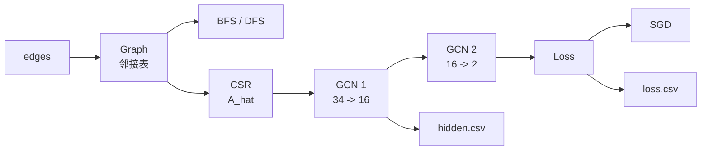
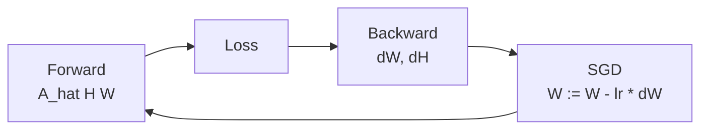

# 图卷积神经网络综合实验

### 基于 C++17 的 GCN（Graph Convolutional Network，图卷积神经网络）实现

<br/>

数据结构综合实验展示

---
hideInToc: true
section: "问题定义"
layout: center
---

# 问题定义

---

# 实验目标

GCN（Graph Convolutional Network，图卷积神经网络）把图结构和节点特征同时纳入计算，使每个节点在更新特征时聚合邻居信息。

<Item title="项目实现">
<div grid="~ cols-2 gap-6" class="text-left text-sm">
<div>

- 图存储与基本操作
- BFS（Breadth-First Search，广度优先搜索）
- DFS（Depth-First Search，深度优先搜索）

</div>
<div>

- CSR（Compressed Sparse Row，压缩稀疏行）矩阵乘法
- GCN（Graph Convolutional Network，图卷积神经网络）前向传播
- 反向传播（backpropagation）与训练闭环

</div>
</div>
</Item>

---

# 数据与任务

<div class="data-layout">
<div>

Zachary's Karate Club 是一个经典社区网络数据集，本实验使用图卷积神经网络来完成该数据集的分类任务。

| 指标 | 数值 |
|---|---:|
| 节点数 | 34 |
| 边数 | 78（带权） |
| 社区类别 | 2 |
| 输入特征 | 34 维 one-hot |

</div>
<div>


</div>
</div>

<style>
.data-layout {
  display: grid;
  grid-template-columns: 0.95fr 1.05fr;
  gap: 2rem;
  align-items: center;
}
.data-layout img {
  max-height: 22rem;
  object-fit: contain;
}
</style>

---
hideInToc: true
section: "系统设计"
layout: center
---

# 系统设计

---

# 模块结构



<div class="text-sm mt-2">

- Graph：以邻接表（adjacency list）表示带权无向图，提供边操作与邻居查询。
- CSR：将归一化邻接矩阵 $\hat{A}$ 压缩存储，支撑稀疏矩阵乘法。
- GCN：执行 $\hat{A}HW$ 的特征传播与维度映射，输出节点类别 logits（未归一化预测值）。
- Loss / SGD：用交叉熵（CrossEntropy）度量分类误差，并通过随机梯度下降（SGD）更新权重。
- CSV：记录隐藏层特征与训练曲线，用于结果分析和可视化。

</div>

---

# 图存储

邻接表（adjacency list）直接保存每个节点的邻居，适合稀疏图（sparse graph）上的遍历和边操作。

```cpp {none|1-3|5-8|10-13}
class Graph {
    // 邻接表：每个节点保存 (邻居编号, 边权重)
    std::vector<std::vector<std::pair<int, double>>> adjList_;

    // 基本边操作：维护无向图结构
    void addEdge(int u, int v, double weight = 1.0);
    void removeEdge(int u, int v);
    bool hasEdge(int u, int v) const;
    std::vector<int> neighbors(int u) const;

    // 图遍历与 GCN 输入矩阵构造
    std::vector<int> bfs(int start) const;
    std::vector<int> dfs(int start) const;
    SparseMatrix toNormalizedCSR() const;
};
```

运行结果：节点 0 的度数为 16；从节点 0 出发，BFS / DFS 均覆盖 34 个节点，连通分量数为 1。

---

# 归一化邻接矩阵

GCN 的核心输入为带自环并经过度归一化的邻接矩阵 $\hat{A}$，用于稳定不同度数节点之间的信息聚合。

$$
\tilde{A} = A + I_N
$$

$$
\hat{A} = \tilde{D}^{-\frac{1}{2}} \tilde{A} \tilde{D}^{-\frac{1}{2}}
$$

<Item title="工程实现">
```cpp
SparseMatrix Graph::toNormalizedCSR() const;
```

该函数完成自环（self-loop）添加、度（degree）计算与非零元素压缩写入，输出 CSR（Compressed Sparse Row，压缩稀疏行）矩阵。
</Item>

---

# CSR 稀疏矩阵

CSR（Compressed Sparse Row，压缩稀疏行）用 3 个数组保存稀疏矩阵：`values_` 保存非零值，`colIndices_` 保存列号，`rowPtr_` 保存每行起止位置。

<div class="csr-layout">
<div class="csr-stats">

| 项目 | 数值 |
|---|---:|
| 矩阵维度 | 34 x 34 |
| 非零元 | 190 |
| 稠密度 | 16.44% |
| 乘法结果误差 | 0.000 |

</div>
<div class="csr-code">

```cpp
DenseMatrix SparseMatrix::dot(const DenseMatrix& B) const {
    DenseMatrix result(rows_, B.cols());
    for (int i = 0; i < rows_; ++i) {
        for (int idx = rowPtr_[i]; idx < rowPtr_[i + 1]; ++idx) {
            int k = colIndices_[idx];
            double a = values_[idx];

            for (int j = 0; j < B.cols(); ++j) {
                result(i, j) += a * B(k, j);
            }
        }
    }
    return result;
}
```

</div>
</div>

<style>
.csr-layout {
  display: grid;
  grid-template-columns: 0.52fr 1.68fr;
  gap: 1rem;
  align-items: start;
}
.csr-code .slidev-code-wrapper {
  width: 100%;
}
</style>

---
hideInToc: true
section: "GCN 实现"
layout: center
---

# GCN 实现

---

# 前向传播

每层 GCN（Graph Convolutional Network，图卷积神经网络）先聚合邻居特征，再做线性变换，最后用 ReLU（Rectified Linear Unit，修正线性单元）引入非线性。

$$
H^{(l+1)} = \sigma\left(\hat{A} H^{(l)} W^{(l)}\right)
$$

```cpp
X_ = X;
AX_ = A_hat.dot(X);
preActivation_ = AX_ * W_;

return gcn::activation::relu(preActivation_);
```

---

# 反向传播与训练

项目实现了实验要求之外的训练闭环：Softmax（归一化指数函数）+ CrossEntropy（交叉熵）计算分类损失，SGD（Stochastic Gradient Descent，随机梯度下降）更新两层 GCN 的权重。



<div class="text-sm mt-2">

- Forward：基于 $\hat{A}HW$ 完成邻居信息聚合与线性映射。
- Loss：用 Softmax（归一化指数函数）+ CrossEntropy（交叉熵）度量节点分类误差。
- Backward：计算权重梯度 $dW$ 与特征梯度 $dH$。
- SGD：按 $W := W - lr \cdot dW$ 更新两层 GCN 权重。

</div>

---

# 训练结果

<div grid="~ cols-2 gap-8">
<div>

| 指标 | 数值 |
|---|---:|
| 网络结构 | 34 -> 16 -> 2 |
| 训练轮数 | 300 |
| 最终 loss | 0.214341 |
| 最终准确率 | 100.0000% |

loss（损失）从 0.693 降到 0.214，accuracy（准确率）从 52.94% 提升到 100.00%。

</div>
<div>


</div>
</div>

---

# 特征变化

<div grid="~ cols-2 gap-6">
<div>

输入特征是单位矩阵，节点之间尚未发生信息传播。


</div>
<div>

隐藏层特征经过 $\hat{A}XW$ 后形成连续表示，邻接关系参与了特征聚合。


</div>
</div>

---
hideInToc: true
section: "总结"
layout: center
---

# 总结

---

# 总结

<div grid="~ cols-2 gap-8" class="text-sm">
<div>

<Item title="数据结构实现">

- Graph：邻接表（adjacency list）、边操作、BFS / DFS、连通分量
- DenseMatrix：矩阵乘法、转置、激活函数与 CSV 输出
- SparseMatrix：CSR（Compressed Sparse Row，压缩稀疏行）存储、稀疏乘法、转置

</Item>

</div>
<div>

<Item title="GCN 训练实现">

- GCNLayer：$\hat{A}HW$ 前向传播与权重更新
- Loss / Optimizer：Softmax（归一化指数函数）、CrossEntropy（交叉熵）、SGD（随机梯度下降）
- Demo 输出：loss 曲线、隐藏层特征、Karate 图结构可视化；最终准确率 100.0000%

</Item>

</div>
</div>

<Item title="核心链路">
邻接表（adjacency list） -> 归一化 CSR（Compressed Sparse Row，压缩稀疏行） -> GCN（Graph Convolutional Network，图卷积神经网络）前向传播 -> 反向传播（backpropagation） -> SGD（Stochastic Gradient Descent，随机梯度下降）训练。
</Item>
