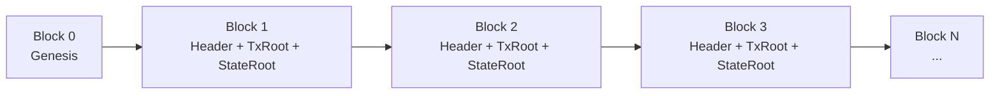
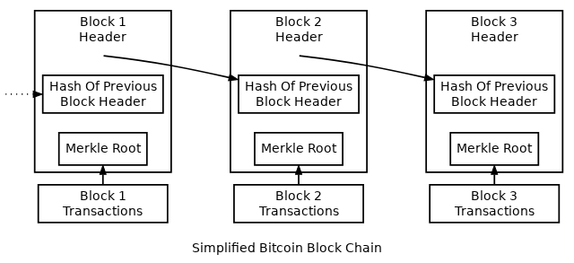
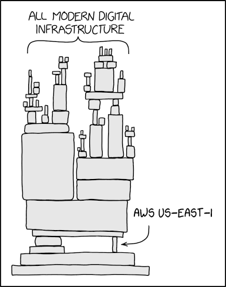
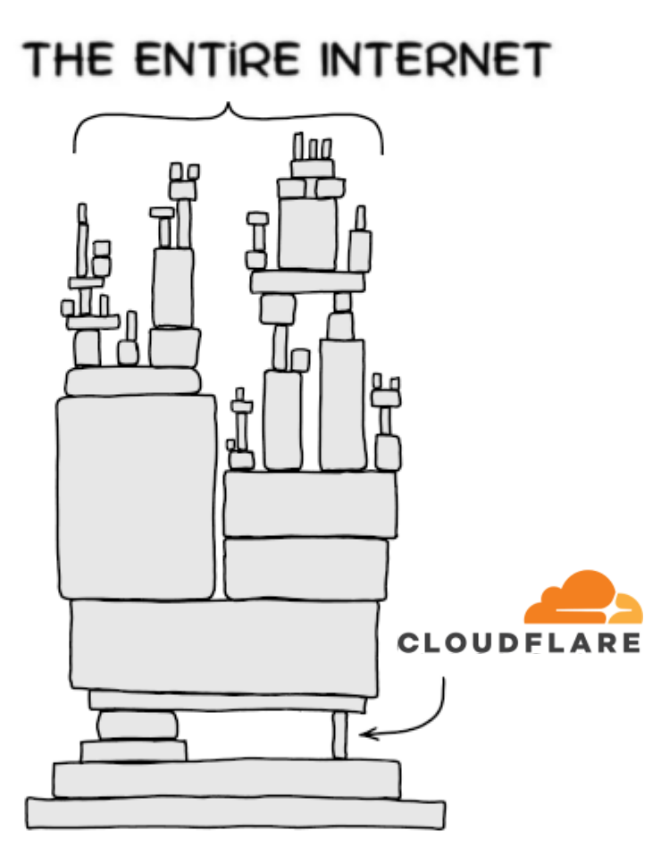
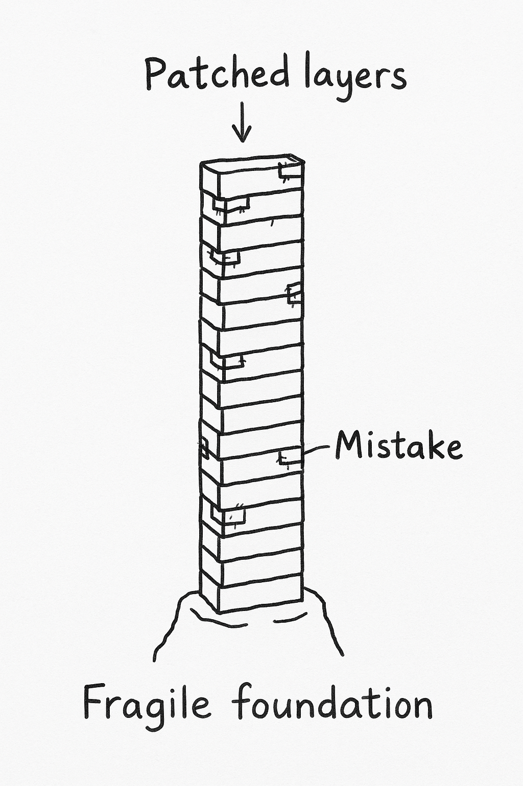

# The Security of Immutable Smart Contracts: A Systematic Survey of Vulnerabilities

## 蒋&nbsp;杰

## 24 网络空间安全
 

#### Nov 24, 2025

<!--
首先需要声明，我们并不鼓励、提倡任何涉及加密货币的行为，但智能合约安全领域的研究仍然非常有价值，因此今天我就智能合约安全领域进行文献综述。

First of all, it must be stated that we do not encourage or promote any activities involving cryptocurrencies.
-->

---
hideInToc: true
section: "Content"
disabled: true
---

# Content

<Toc />

<!--
Here is another comment.
-->

---
section: Introduction
layout: center
hideInToc: true
---

# Introduction

---

# Introduction

Bitcoin is a cryptocurrency built on blockchain technology. The Bitcoin community advocates the idea of decentralization. By leveraging blockchain technology, transactions made with Bitcoin are characterized by irreversibility, immutability, and resistance to forgery.

A blockchain is a distributed ledger system constructed upon P2P networks, public-key cryptography, and consensus mechanisms. Its core philosophy is to achieve decentralization through distributed system design, enabling transactions to be conducted openly and transparently across the network.

<!--
比特币是一种加密货币，基于区块链的技术。比特币社区推崇去中心化的理念，通过区块链技术，使用比特币进行的交易具有不可撤销、不可修改、不可伪造等特性。

区块链是建立在 P2P 网络、公钥密码学、共识机制等技术上的分布式记账系统，其理念是通过分布式系统达成去中心化的目标，让交易能够公开透明的在网络上进行。
-->

The Smart Contracts are based on the Blockchain, actually they are several programs running on the nodes in distributed network. They are programs, so there are vulnerabilities in the programs.

<!--
On October 31, 2008, Satoshi Nakamoto published a paper on Bitcoin. The following year, Bitcoin was officially introduced, marking the birth of a decentralized financial system.
So, what exactly is Bitcoin? And what is blockchain?
Bitcoin is…
Blockchain is…
2008年10月31日，中本聪发表了一篇关于比特币的论文，次年，比特币正式问世，去中心化的金融体系正式诞生。
那么，什么是比特币呢？什么是区块链呢？
比特币是...
区块链是...
-->

---
section: Background
layout: center
hideInToc: true
---

# Background

---

# Blockchain

> A blockchain is a distributed ledger with growing lists of records (blocks) that are securely linked together via cryptographic hashes. Each block contains a cryptographic hash of the previous block, a timestamp, and transaction data (generally represented as a Merkle tree, where data nodes are represented by leaves). 
> 
> —— Wikipedia for Blockchain

In simple terms, a blockchain records messages broadcast to a distributed network, forming an immutable chain of blocks. Any attempt to tamper with a block in the middle would break the linkage of all subsequent blocks, making modification immediately detectable.

<!--
简单来说，区块链将广播到分布式网络中的消息记录下来，形成一个不可修改的块链，一旦试图篡改中间区块，都会导致后续区块的链条断掉。
-->

---

# Blockchain

{width=400px}

| Field     | Description                        |
|-----------|------------------------------------|
| Prt.Hash  | Hash of the parent block header    |
| StateRoot | Root hash of the global state trie |
| TxRoot    | Root hash of the transaction trie  |
| ...       | ...                                |

<arrow v-click x1="500" y1="245" x2="310" y2="245" color="brown" width="2" arrowSize="1" />

Each block’s `Hash Of Previous Block Header` stores the hash of the previous block’s `Block Header`, and together with the PoS/PoW mechanism, ensures that the chain cannot be tampered with.

<!--
<v-click>每个区块的 `Hash Of Previous Block Header` 都储存了上一个区块的 `Block Header` 的 `Hash`，与 PoS/PoW 机制共同保证了链不可篡改。</v-click>
-->

---

# Blockchain - Features

> Blockchain infrastructure platform Alchemy recently released its Q3 2022 report stating that approximately 118,000 smart contracts were deployed and verified on the blockchain in the three quarters of 2022, an increase of approximately 50% over 2021.  

- Advantages
    - Immutability
    - Decentralization
    - Transparency
    - Security
- Disadvantages
    - High Energy Consumption (mentioned later)
    - Irreversibility
    - Governance Challenges (e.g. money laundering)

---

# Ethereum

Ethereum is an open, public blockchain launched in July 2015 by a software developer called Vitalik Buterin and a small team of co-founders.

The idea behind Ethereum was simple. While Bitcoin let you send and receive digital cash, Ethereum would build on this with open-source programs called smart contracts.

This is the most significant feature in contrast to Bitcoin. And another feature is it use PoS, is how all computers agreed on who owns what. In addition, Ethereum use **ETH** as its native cryptocurrency.

<Item title="Proof of stake(PoS)">
Instead of mathematical puzzles, validators lock their ETH as a security deposit to earn the right to process transactions. If they do it correctly, they earn ETH. If they cheat, they lose some of their stake.
</Item>

---

# Smart Contracts

Smart contracts are the fundamental building blocks of Ethereum's application layer. They are computer programs stored on the blockchain that follow "if this then that" logic, and are guaranteed to execute according to the rules defined by its code, which **cannot be changed once created\[4\]**.

But why are they called "contracts"?
- conventional contracts
- law
- buying
- Automatic execution

<!--
着重解释不可撤回
我们是人类，人类不可避免的会犯错误，程序也不可避免的会有 Vulnerabilities.
We are human, and humans inevitably make mistakes. Likewise, programs are also prone to vulnerabilities.
-->

---

# The Computer World

<!--上个月 Amazon Web Services 崩了...-->
Last month, Amazon Web Services went down…

{width=250px}

---

# The Computer World

A few days ago, Cloudflare went down again…  
And even platforms like Zhihu, CSDN, Bilibili, and NetEase Cloud Music have all experienced similar outages in recent years…

<!--
前几天 Cloudflare 又崩了...  
甚至知乎、CSDN、Bilibili、网易云等公司/网站近些年都发生过类似的事情...
-->

{width=250px}

---

# The Computer World (In My Opinion)

Perhaps this is what the real world of computing looks like—an enormous tower where every layer is critically important, yet patched and repaired over time (this is the prompt I used to ask ChatGPT to generate).

<!--
或许这才是真正的计算机世界（这是我让 ChatGPT 生成的，一个每一层都极其重要，但充满补丁的计算机大厦）：
-->

 {width=230px}

---
section: Common Vul.
layout: center
---

# Common Vulnerabilities in Smart Contracts

---

# Common Vulnerabilities in Smart Contracts

> According to SlowMist Hacked, as of the end of June, there were 187 blockchain security incidents across the network since we entered 2022, while the losses suffered amounted to $1.976 billion. Out of the 19,366 Ethereum contracts that are now in existence, Liao et al. (2022) discovered that 8,833 of them are insecure, indicating that the vulnerability percentage is still high and that the security vulnerabilities in these smart contracts might lead to financial losses.

Main Security vulnerabilities:

- Solidity
- EVM bytecode
- Blockchain

<!--
此处需要举一些例子
-->

---
section: Related Work
layout: center
---

# Related Work

---

# Related Work

With the rapid development of large language models (LLMs), artificial intelligence has introduced significant changes to the field of smart contract security. In particular, many recent studies incorporate LLMs into vulnerability discovery, demonstrating strong capabilities in code understanding and automated auditing. As shown in prior work \[3\], LLMs perform well in analyzing contract logic and identifying common security flaws.

Research on smart contract security spans a broad spectrum beyond LLM-based analysis. Early work focuses on static analysis, symbolic execution, and formal verification to detect vulnerabilities in contract logic. Tools such as Slither, Mythril, and Certora Prover provide foundational approaches for identifying reentrancy, arithmetic bugs, and access-control issues.

---
section: Real Attacks
layout: center
---

# Real-World Attacks

---

# Real-World Attacks

Smart contract ecosystems are still relatively immature, and their strong political and economic attributes make them frequent targets of attackers seeking to achieve social or financial objectives. We illustrate this with two representative incidents.

### The DAO

In brief, starting on April 30, 2016, a startup team known as “The DAO” launched an ICO-style crowdfunding campaign through a smart contract on Ethereum. Over a 28-day period, they raised approximately 150 million USD, making it the largest crowdfunding project in history at the time.

On June 12, Stephan Tual, one of The DAO’s founders, announced that they had discovered a “recursive call vulnerability” in the contract’s code. Unfortunately, while developers were working to fix this flaw and other issues, an unknown attacker began exploiting the vulnerability to siphon off Ether raised by The DAO. By June 18, the attacker had successfully extracted more than 3.6 million Ether and transferred it into a child DAO—an organization structurally identical to The DAO itself.
<!--
智能合约领域由于生态尚不成熟，且政治属性和经济属性比重较大，经常遭到黑客的攻击以期达到社会、经济等方面的目的。我们通过两例攻击来举例说明。

### The Dao

简单地讲，在2016年4月30日开始，一个名为“The DAO”的初创团队，在以太坊上通过智能合约进行ICO众筹。 28天时间，筹得1.5亿美元，成为历史上最大的众筹项目。

THE DAO创始人之一Stephan TualTual在6月12日宣布，他们发现了软件中存在的“递归调用漏洞”问题。 不幸的是，在程序员修复这一漏洞及其他问题的期间，一个不知名的黑客开始利用这一途径收集THE DAO代币销售中所得的以太币。6月18日，黑客成功挖到超过360万个以太币，并投入到一个DAO子组织中，这个组织和THE DAO有着同样的结构。
-->

---

# Real-World Attacks

### EXTCODESIZE Vulnerability

EXTCODESIZE is an Ethereum instruction whose execution logic is as follows:

It queries the state database to check whether a given address contains contract code

It then retrieves the length of the stored code

<v-click>
Therefore, this instruction essentially performs an I/O operation, yet in early Ethereum it was priced relatively cheaply.
</v-click>

<v-click>
As a result, in September 2016, an attack exploited the underpriced EXTCODESIZE operation. During the attack, block creation times spiked to over 30 seconds, whereas under normal circumstances blocks are produced roughly every 15 seconds.
</v-click>

<!--
### EXTCODESIZE Vulnerability

`EXTCODESIZE` 是以太坊的一条指令，它的执行逻辑是：

- 去状态数据库中查找某地址是否存有代码 <!-- .element: class="fragment"
- 读取存储的代码长度 <!-- .element: class="fragment"

<v-click>
所以这实际上是一条进行 I/O 操作的指令，但是最初以太坊对它的定价是比较低的.
</v-click>

<v-click>
因此，在 2016 年 9 月，发生了利用 `EXTCODESIZE` 较低定价的一场攻击，攻击期间区块的创建时间峰值甚至超过了 30 s，而一般情况下区块的创建时间大概是 15 s.
</v-click>
-->

---

# Intent Behind the Attacks

As mentioned earlier, certain attacks are not purely financially motivated; they may also carry political intentions or other non-economic objectives.

<v-click>
Blockchain must uphold the principle of decentralization.
</v-click>

<v-click>
The fundamental distinction between blockchain and traditional centralized institutions such as banks lies in the consensus mechanism.
</v-click>

<v-click>
Both smart contracts and their underlying blockchain infrastructure still have a long way to go before reaching maturity.
</v-click>

---
section: End
layout: center
---

# Thanks for Your Listening

---
section: References
---

# References

\[1\] Guangfu Wu, HaiPing Wang, Xin Lai, Mengmeng Wang, Daojing He and Sammy Chan. A comprehensive survey of smart contract security: State of the art and research directions. In Journal of Network and Computer Applications, vol. 226, 2024, Article 103882.  
\[2\] Huaqun Guo and Xingjie Yu. A Survey on Blockchain Technology and Its Security. In Blockchain: Research and Applications, 3(2), 100067, 2022  
\[3\] Ye Liu, Yue Xue, Daoyuan Wu, Yuqiang Sun, Yi Li, Miaolei Shi and Yang Liu. PropertyGPT: LLM-driven Formal Verification of Smart Contracts through Retrieval-Augmented Property Generation. In Proceedings of the NDSS Symposium 2025 (NDSS ’25), 2025  
\[4\] Nicola Ruaro, Fabio Gritti, Dongyu Meng, and Robert McLaughlin, Ilya Grishchenko, Christopher Kruegel and Giovanni Vigna. Approve Once, Regret Forever: On the Exploitation of Ethereum's Approve-TransferFrom Ecosystem. In Proceedings of the USENIX Security Symposium 2025 (USENIX Security ’25), 2025
