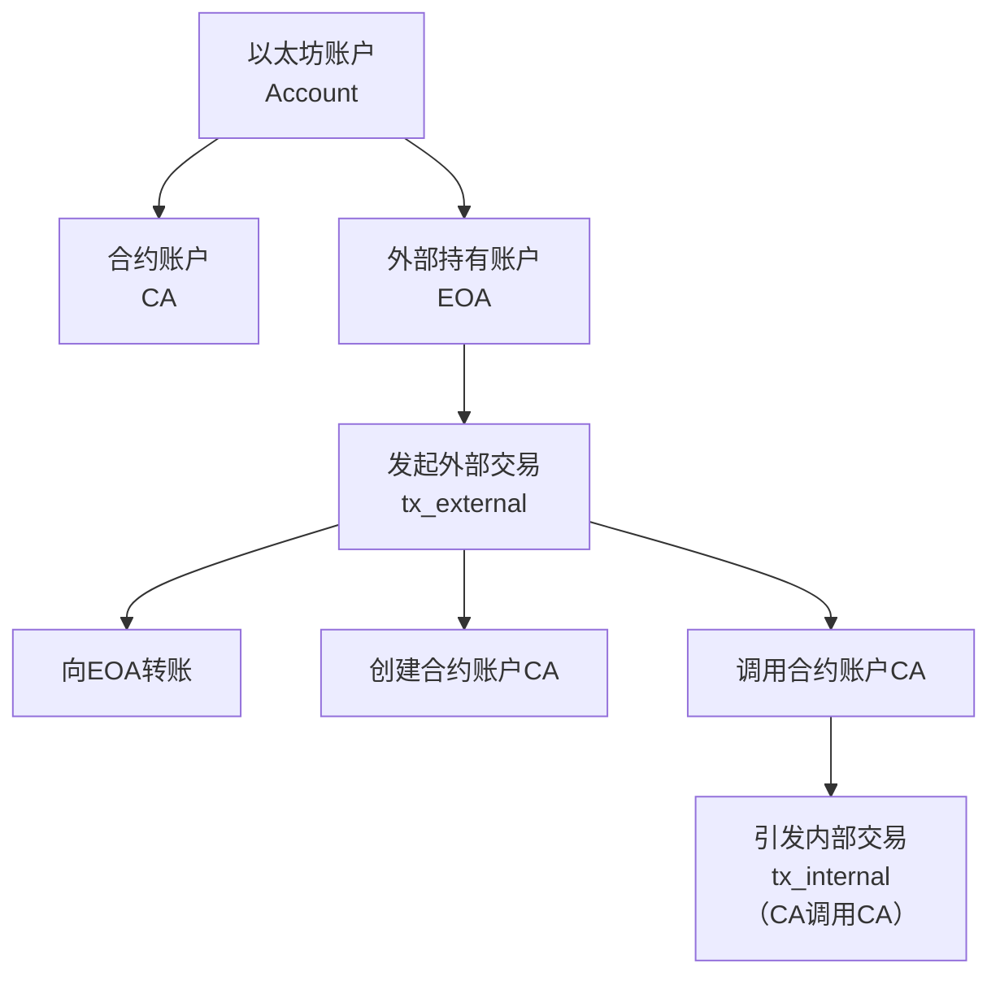
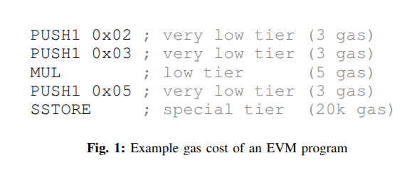
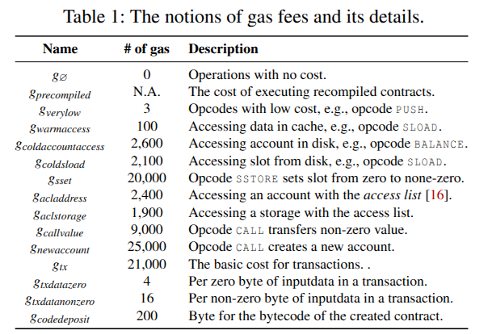

# Auspex: Unveiling Inconsistency Bugs of Transaction Fee Mechanism in Blockchain

### <b>The Balance between Resources and Fee</b>

<br/>

## 蒋杰

## 24 网络空间安全
<br/>

#### 2025 年 11 月 22 日

<style>
  h2 {
    font-family: SimSun;
    font-size: 1.2rem;
  }
  
  h1,
  h3,
  h4 {
    font-family: SimSun !important;
  }
</style>


---
hideInToc: true
section: "目录"
disabled: true
---

# 目录

<Toc />

<!--
Here is another comment.
-->

---
section: "背景"
layout: two-cols
level: 2
---

# 背景

区块链中的 Transaction fee mechanism (TFM) 机制通过根据资源使用情况向用户收费来防止资源的滥用.

通俗来说就是根据指令可能造成的资源消耗给每条指令规定统一的价格 （gas），若用户想要执行智能合约，就需要缴纳对应的 gas.

<v-click><p>但是在收取的费用和实际使用的资源之间往往存在不一致性，即 TFM inconsistency bugs.</p></v-click>

<v-click>我们首先简单解释智能合约的计费规则.</v-click>

::right::

#
<br/>



---

# 背景

通过下面这个程序举例

<div class="two-columns">
    <div class="col">
        
    </div>
    <div class="col">
        
    </div>
</div>

交易成本是：

```js
21,000 + 3 + 3 + 5 + 3 + 2,000 = 41,014 gas
```

<v-click>下面通过一个真实的攻击案例解释更一般的因计价不合理造成的 DOS 攻击</v-click>

<style>
    .two-columns {
        height: 40% !important;
        display: flex;
        justify-content: center;
        gap: 20px;            /* 两张图片之间的距离，可调整 */
    }
  
    .col {
        flex: 1;              /* 两个 column 等宽 */
        display: flex;
        justify-content: center;
    }
  
    img {
        width: 100%;          /* 图片自动等宽填充列 */
        height: auto;         /* 按比例缩放 */
        object-fit: contain;  /* 保持完整不裁切 */
    }
</style>

---

# 背景 - EXTCODESIZE 攻击

`EXTCODESIZE` 是以太坊的一条指令，它的执行逻辑是：

- 去状态数据库中查找某地址是否存有代码 <!-- .element: class="fragment" -->
- 读取存储的代码长度 <!-- .element: class="fragment" -->

<v-click><p>所以这实际上是一条进行 I/O 操作的指令，但是最初以太坊对它的定价是比较低的.</p></v-click>

<v-click><p>因此，在 2016 年 9 月，发生了利用 `EXTCODESIZE` 较低定价的一场攻击，攻击期间区块的创建时间峰值甚至超过了 30 s，而一般情况下区块的创建时间大概是 15 s.</p></v-click>

---

# 背景 - 以太坊改进提案（EIP）150

> 虽然在最初设计 EVM 时就已经确定了各条指令的执行成本，但研究人员发现部分成本与实际资源消耗并不匹配。尤其是，I/O 密集型指令的成本往往过低，从而允许攻击者在以太坊区块链上发动拒绝服务（DoS）攻击。为了解决这一问题，EIP 150 被提出并实施，通过显著提高那些需要执行 I/O 操作（例如 SLOAD 或 EXTCODESIZE）的指令的 gas 消耗来进行修正。
> 
> —— Broken Metre: Attacking Resource Metering in EVM

通过调整计价，确实可以缓解像前面所说的 `EXTCODESIZE` 这样的低计价重 I/O 指令存在的风险，但是有一些指令仅在一些较特殊的 context 下才会被触发，比如不同节点的操作系统或应用层面的缓存造成的 I/O 消耗的巨大差异。

本文就是利用模糊测试提高寻找 TFM 不一致漏洞的效率.

---
section: "提出问题"
---

# 提出问题

<Item title="TFM 不一致性漏洞">
<p style="margin:0">
一种以用户被收取的费用与实际使用的计算资源之间的差异为特征的漏洞。这些 TFM 不一致性漏洞可能导致收费过高或过低，从而破坏系统的安全性和稳定性。
</p>
</Item>

多项研究尝试研究 TFM 不一致性漏洞，但它们无法全面地发现 TFM 不一致性漏洞。这些研究通常为每个指令码（即低级虚拟机指令）手动设计基准测试。通过分析基准测试的结果，研究人员判断当前指令码的费用是否与其执行时间相匹配，这些研究的缺陷在于：

- **测试用例生成效率低**：基准测试依赖手工构造测试用例；
- **测试覆盖不全**：手工构造无法考虑的所有情景；
- **无法进行自动化分析**


---
# layout: center
# class: text-center
---

# Learn More

<Item title="Theorem1">
定理测试
$$
\begin{align*}
	M_A(x)
	&=
	\frac{\log2}{\delta}x-\frac{1}{\delta}\frac{x\log\log x}{\log x}+
	\frac{1}{\delta}\left(\gamma-\log\frac{\delta}{4}\right)\frac{x\log\log x}{\log x}\\
	&\qquad+
	\frac{1}{2\delta}\frac{x(\log\log x)^2}{\log^2 x}+O_A\!\left(\frac{x\log\log x}{\log^2 x}\right).
\end{align*}
$$    
</Item>

[Documentation](https://sli.dev) · [GitHub](https://github.com/slidevjs/slidev) · [Showcases](https://sli.dev/resources/showcases)

<PoweredBySlidev mt-10 />
